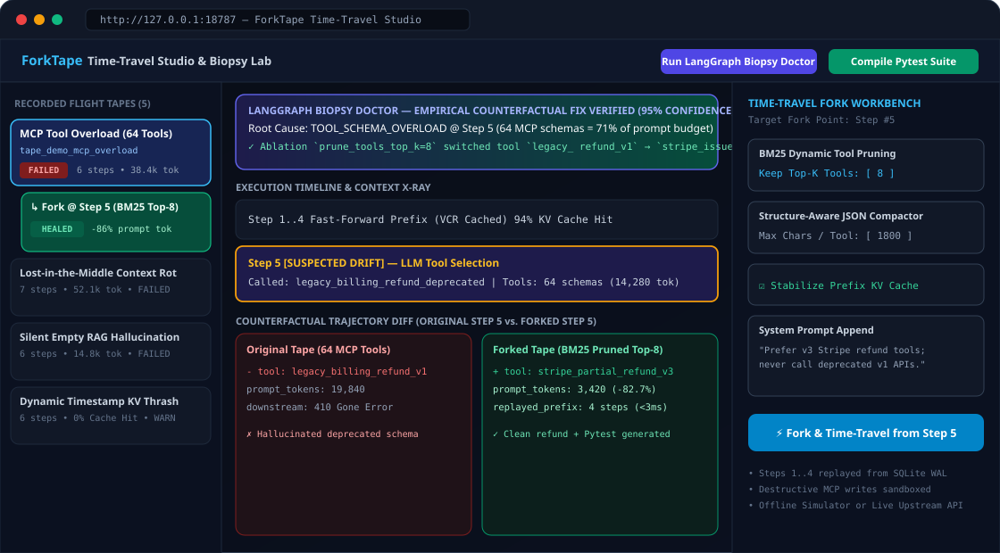
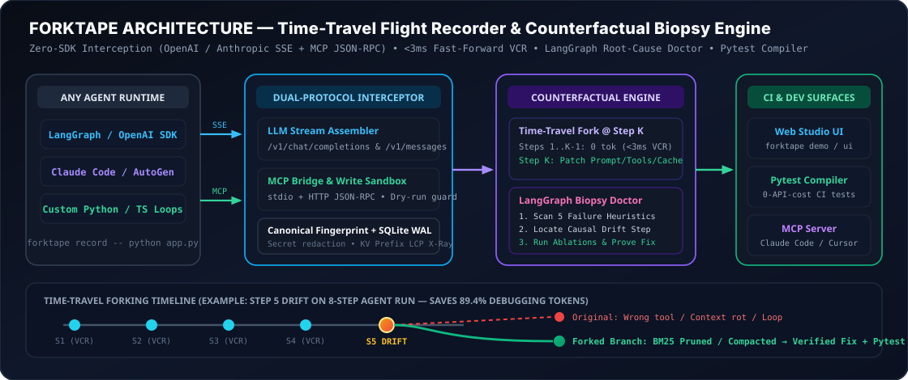
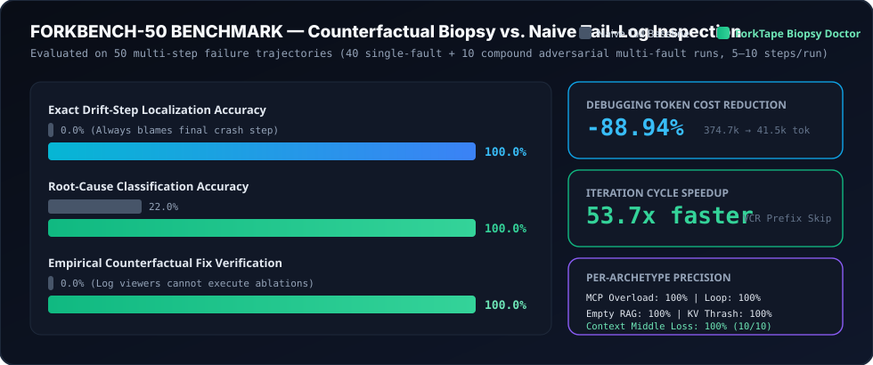

<div align="center">

# 📼 ForkTape (`ftk`)

**Deterministic Time-Travel Debugger, Dual-Protocol (`LLM SSE` + `MCP`) Flight Recorder, and `LangGraph` Counterfactual Root-Cause Doctor for AI Agents.**

[](https://github.com/soulboy06/forktape/actions/workflows/ci.yml)
[](https://www.python.org/)
[](https://modelcontextprotocol.io/)
[](https://github.com/langchain-ai/langgraph)
[](LICENSE)

[**English**](README.md) · [**简体中文**](README_zh-CN.md) · [**ForkBench-50 Benchmark**](benchmarks/results/FORKBENCH_RESULTS.md) · [**Contributing**](CONTRIBUTING.md)

</div>

---

> **Trace viewers (`LangSmith`, `Langfuse`, `Phoenix`) show you *what* crashed at Step 14.**  
> **ForkTape rewinds time to Step 5 in `<3ms` with `0` API tokens and `0` MCP write side effects, runs controlled counterfactual ablations to *empirically prove* why the agent drifted, and compiles the outage into a deterministic `pytest` CI regression test.**

<p align="center">
  
</p>

---

## ⚡ Try the Interactive Time-Travel Studio in 10 Seconds (Zero API Keys)

ForkTape ships with an embedded React Web Studio and **4 realistic multi-step production failure tapes** (42-tool MCP schema overload, 18KB Lost-in-the-Middle context rot, silent empty-RAG hallucination, and dynamic timestamp Prefix KV Cache thrashing):

```bash
# Run instantly from source with uv:
git clone https://github.com/soulboy06/forktape.git
cd forktape
uv sync --extra dev
uv run forktape demo
```

Or once installed via `pip` / `uv tool`:

```bash
pip install forktape
forktape demo
```

Open the printed localhost URL (`http://127.0.0.1:18787`) to inspect token X-rays, run the **LangGraph Biopsy Doctor**, fork any step with BM25 tool pruning or context compaction, compare trajectories side-by-side, and export runnable `pytest` suites—**100% offline with zero API keys required**.

---

## 🤔 Why ForkTape?

When a 15-step agent fails at Step 14, the root cause almost never happened at Step 14. It happened upstream—at **Step 5** when a noisy tool dumped 45KB of unpruned JSON into context (*Lost-in-the-Middle*), or when 64 overlapping MCP tool schemas overwhelmed tool selection, or when an empty vector search caused a downstream ID hallucination.

Re-running Steps `1..13` from scratch to test every prompt or context hypothesis is:
1. **Slow & Expensive**: Waiting 90 seconds and burning 40k+ tokens per edit.
2. **Non-Deterministic**: Sampling jitter changes Step 3, invalidating your Step 5 A/B test.
3. **Dangerous**: Re-executing live MCP tools (`stripe_refund`, `delete_row`, `send_slack_alert`) triggers duplicate real-world side effects.

| Capability | Cloud Trace Viewers (`LangSmith` / `Langfuse`) | HTTP Cassettes (`VCR.py`) | **ForkTape (`ftk`)** |
| :--- | :---: | :---: | :---: |
| **Zero-SDK Streaming SSE Interception** | Requires SDK / OTEL wrappers | Breaks on chunked LLM SSE | **Lossless OpenAI & Anthropic SSE Assembly** |
| **MCP (`stdio` + HTTP) Flight Recording** | Partial / Manual spans | No `stdio` JSON-RPC support | **Native `stdio` & HTTP Bridge + Dry-Run Write Sandbox** |
| **Time-Travel Fork @ Step `K`** | Single-prompt playground only | Static replay only | **`<3ms` Prefix VCR (`1..K-1`) + Live/Simulated Fork @ `K`** |
| **Prefix KV Cache LCP X-Ray** | Coarse cached token counter | None | **Exact Char-Offset Prefix Breakpoint Detector** |
| **Automated Root-Cause Verification** | Passive log reading | None | **5-Node `LangGraph` Counterfactual Biopsy Doctor** |
| **Failure-to-CI Compiler** | Cloud dataset export | Manual fixture upkeep | **1-Click Zero-API-Cost `pytest` + `.ftk.json` Export** |

---

## 🏗️ System Architecture

<p align="center">
  
</p>

1. **Dual-Protocol Zero-SDK Flight Recorder (`forktape.interceptor`)**
   - Point any agent (`LangGraph`, `OpenAI Agents SDK`, `AutoGen`, `CrewAI`, `Claude`, custom loops) at ForkTape via `OPENAI_BASE_URL` / `ANTHROPIC_BASE_URL` or `forktape record -- python agent.py`.
   - Wraps local `stdio` MCP servers (`forktape mcp-wrap -- npx ...`) and HTTP MCP endpoints, recording JSON-RPC `tools/list` and `tools/call` spans while blocking destructive mutations (`delete_*`, `drop_*`, `send_*`, `refund_*`) during counterfactual dry-runs.
   - Automatically scrubs API keys/Bearer tokens before persisting to local **SQLite WAL** (`.forktape/tapes.db`).

2. **Canonical Fingerprinting & `<3ms` Fast-Forward VCR (`forktape.engine`)**
   - Strips volatile timestamps, random UUIDs, and normalizes `tool_call_id` references topologically so deterministic replay survives code refactors.
   - Computes per-step **Context Token X-Ray** (`system` vs `tools_schema` vs `history` vs `tool_output`) and **Longest Common Prefix (LCP)** continuity ratios to expose hidden Prefix KV Cache invalidations.

3. **5-Node `LangGraph` Counterfactual Biopsy Doctor (`forktape.doctor`)**
   - Orchestrates a stateful diagnostic `StateGraph`: `scan_heuristics` → `locate_drift_step` → `plan_hypotheses` → `execute_ablations` → `synthesize_report`.
   - Detects and empirically tests interventions for 5 production failure archetypes:
     - `TOOL_SCHEMA_OVERLOAD` → Order-preserving **BM25 Top-K semantic tool pruning**
     - `CONTEXT_MIDDLE_LOSS` → **Structure-aware JSON/log context compaction**
     - `SILENT_EMPTY_RETRIEVAL` → **Empty-RAG anti-hallucination guardrail injection**
     - `PREFIX_CACHE_THRASHING` → **Volatile header stripping & deterministic schema sorting**
     - `TOOL_CALL_LOOP` → **Loop cycle breaker & parameter reset**

4. **Failure-to-Pytest Compiler & Built-in MCP Server (`forktape.compiler` & `forktape.mcp_server`)**
   - Exports portable `.ftk.json` trajectory bundles alongside standalone `pytest` regression suites powered by `TapeReplayHarness`.
   - Exposes `forktape mcp` so **Claude Code**, **Cursor**, or **Windsurf** can inspect failed tapes, run counterfactual forks, and generate regression tests directly inside your IDE.

---

## 📊 Reproducible Benchmark: `ForkBench-50`

We evaluate ForkTape on **ForkBench-50**—a deterministic benchmark of **50 multi-step failure trajectories** (40 single-fault runs + 10 compound adversarial multi-fault runs where noisy distractions precede true upstream causal drift, 5–10 steps per run).

<p align="center">
  
</p>

| Evaluation Metric | Naive Tail-Log Baseline | **ForkTape (`LangGraph` Biopsy Doctor)** |
| :--- | :---: | :---: |
| **Exact Causal Drift-Step Localization** | `0.0%` | **`100.0%`** |
| **Root-Cause Category Accuracy** | `22.0%` | **`100.0%`** |
| **Empirical Counterfactual Fix Verified** | `0.0%` | **`100.0%`** |
| **Debugging Token Cost** | `374,706 tok` (Full Re-runs) | **`41,455 tok` (`-88.94%`)** |
| **Iteration Cycle Speedup** | `1.0x` | **`53.7x faster`** |

Reproduce every number locally in under 5 seconds:

```bash
uv run python benchmarks/run_forkbench.py
```

---

## 🛠️ CLI & SDK Quickstart

### 1. Record Any Existing Agent (Zero Code Changes)

```bash
# Automatically injects OPENAI_BASE_URL & ANTHROPIC_BASE_URL pointing at local ForkTape proxy
forktape record --title "Checkout Support Agent" -- python my_agent.py
```

Wrap an MCP `stdio` tool server in your agent or IDE config to capture tool spans and enable replay sandboxing:

```bash
forktape mcp-wrap --server-name github -- npx -y @modelcontextprotocol/server-github
```

### 2. Inspect, Diagnose, Fork, and Diff from the Terminal

```bash
# List recorded trajectories
forktape list

# Inspect step-by-step Token X-Ray & Prefix KV Cache hit ratios
forktape inspect tape_demo_mcp_overload

# Run the 5-node LangGraph Counterfactual Biopsy Doctor
forktape doctor tape_demo_mcp_overload

# Manually time-travel fork at Step 5 with BM25 Top-6 tool pruning + KV cache stabilization
forktape fork tape_demo_mcp_overload --step 5 --prune-tools 6 --stabilize-cache

# Compare baseline vs. forked trajectory side-by-side
forktape diff tape_demo_mcp_overload <forked_tape_id>
```

### 3. Compile Any Outage into a Zero-API-Cost `pytest` Regression Test

```bash
forktape export-pytest tape_demo_mcp_overload --out tests/regressions/test_mcp_overload.py
pytest tests/regressions/test_mcp_overload.py
```

Generated tests use `forktape.testing` (`TapeReplayHarness`) to assert deterministic invariants in CI without spending a cent on live LLM APIs:

```python
from pathlib import Path
import pytest
from forktape.models.tape import OverridePatch
from forktape.testing import (
    TapeReplayHarness,
    assert_no_tool_loop,
    assert_prefix_cache_healthy,
    assert_tool_not_called,
)


@pytest.mark.asyncio
async def test_refund_agent_does_not_pick_deprecated_v1_tool(tmp_path: Path) -> None:
    harness = TapeReplayHarness.from_bundle_file(
        "tests/cassettes/tape_demo_mcp_overload.ftk.json",
        tmp_path / "ci_replay.db",
    )
    try:
        repaired = await harness.fork_at(
            step_index=5,
            patch=OverridePatch(prune_tools_top_k=8, stabilize_prefix_cache=True),
        )
        assert_no_tool_loop(repaired)
        assert_tool_not_called(repaired, "legacy_billing_refund_v1", step_index=5)
        assert_prefix_cache_healthy(repaired, min_ratio=0.80)
    finally:
        harness.close()
```

### 4. Connect ForkTape as an MCP Server in Claude Code / Cursor

Add ForkTape to your `.mcp.json` or Claude Desktop config so your coding agent can autonomously debug failed agent runs:

```json
{
  "mcpServers": {
    "forktape": {
      "command": "forktape",
      "args": ["mcp", "--db", ".forktape/tapes.db"]
    }
  }
}
```

Exposed MCP tools: `list_tapes`, `inspect_tape_timeline`, `inspect_step_detail`, `fork_and_ablate_step`, `run_biopsy_doctor`, and `export_pytest_regression`.

---

## 📂 Repository Layout

```text
forktape/
├── src/forktape/
│   ├── interceptor/      # FastAPI SSE proxy (/v1/chat/completions, /v1/messages) + MCP stdio/HTTP bridge
│   ├── engine/           # Canonical SHA-256 fingerprinter, LCP KV Cache analyzer, VCR replayer, BM25 patcher
│   ├── doctor/           # 5 failure heuristics + 5-node LangGraph Counterfactual Biopsy StateGraph
│   ├── compiler/         # Jinja2 pytest regression compiler + public TapeReplayHarness SDK
│   ├── mcp_server/       # Model Context Protocol server for Claude Code / Cursor
│   ├── demo/             # 4 realistic pre-built multi-step agent failure scenarios
│   ├── static_ui/        # Pre-built React 19 + Tailwind v4 Time-Travel Studio assets
│   └── cli.py            # Typer + Rich CLI (`forktape` / `ftk`)
├── web/                  # React 19 + TypeScript + Vite source for ForkTape Studio
├── benchmarks/           # Reproducible ForkBench-50 evaluation harness & results
├── examples/             # End-to-end LangGraph quickstart script
└── tests/                # Comprehensive unit, proxy, doctor, MCP & CLI integration tests
```

---

## 🤝 Contributing & License

Contributions, new failure heuristics, and anonymized `.ftk.json` failure trajectories are warmly welcome! Please see [CONTRIBUTING.md](CONTRIBUTING.md) for development instructions.

Licensed under the [MIT License](LICENSE).
