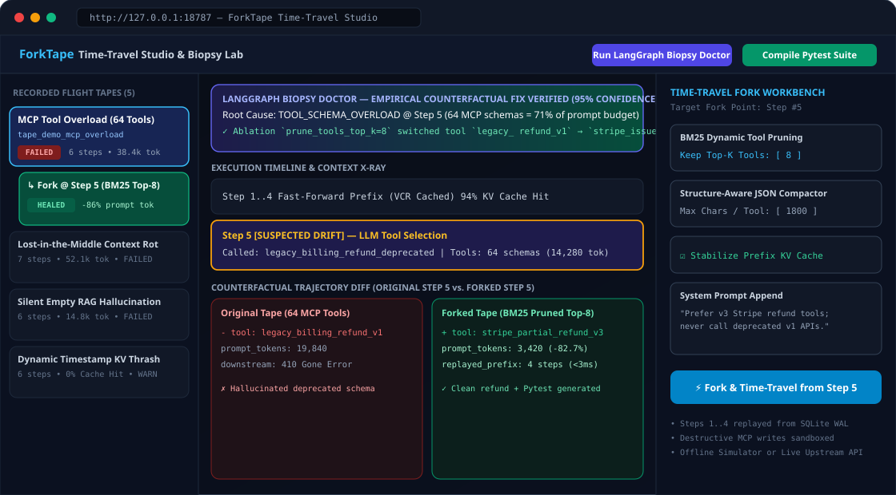
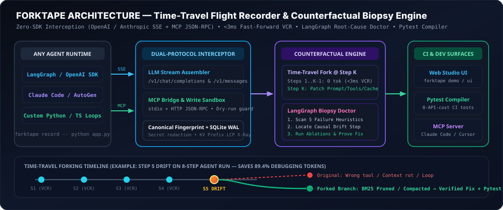
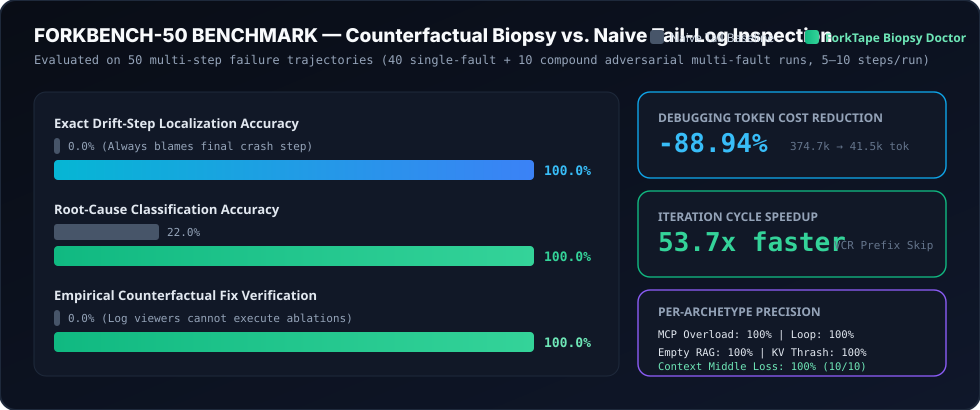

<div align="center">

# 📼 ForkTape (`ftk`)

**面向 AI Agent 的确定性时间旅行调试器、双协议（`LLM SSE` + `MCP`）飞行记录仪与 `LangGraph` 反事实根因诊断引擎。**

[](https://github.com/soulboy06/forktape/actions/workflows/ci.yml)
[](https://www.python.org/)
[](https://modelcontextprotocol.io/)
[](https://github.com/langchain-ai/langgraph)
[](LICENSE)

[**English**](README.md) · [**简体中文**](README_zh-CN.md) · [**ForkBench-50 评测报告**](benchmarks/results/FORKBENCH_RESULTS.md) · [**面试与推广实战手册**](docs/INTERVIEW_AND_STAR_PLAYBOOK.md)

</div>

---

> **传统的 Trace 看板（`LangSmith`、`Langfuse`、`Phoenix`）只能告诉你 Agent 在第 14 步“挂在了哪里”；**  
> **ForkTape 能在 `<3ms` 内以 `0` Token 消耗、`0` 外部写副作用将时间倒流回第 5 步，通过 `LangGraph` 反事实消融实验用数据*证实*故障根因，并一键把线上事故编译为零 API 成本的 `pytest` 回归测试。**

<p align="center">
  
</p>

---

## ⚡ 10 秒零配置体验（无需任何 API Key）

ForkTape 内置预编译的 React 19 时间旅行工作台（Web Studio）以及 **4 组高度还原的线上多步 Agent 翻车磁带**（42 个 MCP 工具 Schema 过载、18KB 上下文腐烂 Lost-in-the-Middle、RAG 静默空召回幻觉、动态秒级时间戳击穿 Prefix KV Cache）：

```bash
git clone https://github.com/soulboy06/forktape.git
cd forktape
uv sync --extra dev
uv run forktape demo
```

或通过 `pip` 安装后直接启动：

```bash
pip install forktape
forktape demo
```

打开终端输出的地址（默认 `http://127.0.0.1:18787`），无需配置任何大模型 Key，即可交互式体验 **Token X-Ray 透视**、**LangGraph 自动根因活检**、**任意步骤时间旅行分叉（Fork）**、**双分支 Diff 对比**与 **Pytest 用例一键导出**。

---

## 🤔 为什么需要 ForkTape？

当一个 15 步的复杂 Agent 在第 14 步调错工具或陷入死循环时，真正的病根往往埋在上游——比如**第 5 步**塞入了 45KB 未裁剪的脏 JSON（*Lost-in-the-Middle 上下文腐烂*），或者挂载了 64 个高度相似的 MCP 工具导致注意力涣散，又或者向量检索静默返回 `[]` 诱发下游捏造业务 ID。

如果靠“改一行 Prompt → 从第 1 步重跑”来排障：
1. **极慢且烧钱**：每次验证都要重跑前 13 步，耗时几十秒、白白消耗数万 Token；
2. **现场无法复现**：温度采样抖动或外部检索结果微变，第 3 步就已经走偏，根本无法对第 5 步做严格控制变量对比；
3. **写操作副作用风险**：重跑过程中重复触发 `stripe_refund`、`delete_row`、`send_email` 等真实 MCP 写工具，极易造成线上脏数据。

| 核心能力对比 | 云端可观测看板 (`LangSmith` / `Langfuse`) | 传统 HTTP 录制 (`VCR.py`) | **ForkTape (`ftk`)** |
| :--- | :---: | :---: | :---: |
| **零 SDK 流式拦截** | 需侵入业务代码埋点 / SDK 包装 | 无法组装与合成大模型 SSE 流 | **无损组装与重放 OpenAI & Anthropic SSE 流** |
| **MCP (`stdio` + HTTP) 录制沙箱** | 缺乏原生 `stdio` 协议拦截 | 不支持 JSON-RPC 子进程流 | **原生 `stdio` / HTTP 桥接 + 写操作干跑沙箱** |
| **任意第 `K` 步时间旅行分叉** | 仅支持单步 Prompt Playground | 只能静态回放，无法中途改道 | **前 `K-1` 步 `<3ms` 0-Token 快进 + 第 `K` 步干预分叉** |
| **Prefix KV Cache 击穿定位** | 仅展示粗粒度缓存数值 | 无 | **字符级最长公共前缀（LCP）断点精确定位** |
| **自动化根因归因验证** | 人工肉眼翻阅长日志 | 无 | **5 节点 `LangGraph` 反事实消融诊断医生** |
| **故障转 CI 回归测试** | 导出云端 Dataset | 手写 Mock 维护成本极高 | **一键编译零 API 成本 `pytest` + `.ftk.json` 磁带** |

---

## 🏗️ 核心架构设计

<p align="center">
  
</p>

1. **双协议零侵入飞行记录仪 (`forktape.interceptor`)**
   - 无需修改业务代码，通过环境变量代理或 `forktape record -- python agent.py` 即可拦截任意框架（`LangGraph`、`OpenAI SDK`、`AutoGen`、`CrewAI`、自研循环）。
   - 支持包装本地 `stdio` MCP Server（`forktape mcp-wrap`）与 HTTP MCP 端点，在分叉实验时自动拦截 `delete_*`、`drop_*`、`send_*` 等破坏性写调用并返回安全干跑回执。
   - 落盘本地 **SQLite WAL** 前自动递归脱敏 `sk-*`、Bearer Token 等敏感凭证。

2. **规范化语义指纹与 `<3ms` 快进引擎 (`forktape.engine`)**
   - 自动剥离动态时间戳、UUID 噪声，并对随机生成的 `tool_call_id` 进行拓扑序重编号，确保重构代码后依然稳定命中录制缓存。
   - 内置消息级 **Context Token X-Ray**（拆解 `System` / `Tools Schema` / `History` / `Tool Output` 占比）与 **Prefix KV Cache LCP 分析器**。

3. **5 节点 `LangGraph` 反事实活检医生 (`forktape.doctor`)**
   - 基于 `LangGraph StateGraph` 编排：`启发式异常扫描` → `上游因果拐点定位` → `反事实假设生成` → `自动分叉消融实验` → `修复报告与测试合成`。
   - 内置五大高频线上故障诊断与自动修复算子：
     - `TOOL_SCHEMA_OVERLOAD` → **保序 BM25 Top-K 动态工具裁剪**（兼顾准确率与 KV Cache 前缀稳定）
     - `CONTEXT_MIDDLE_LOSS` → **结构感知 JSON/长日志定点压缩**
     - `SILENT_EMPTY_RETRIEVAL` → **空检索防幻觉强约束护栏注入**
     - `PREFIX_CACHE_THRASHING` → **动态时间戳剥离与工具字典序稳定化**
     - `TOOL_CALL_LOOP` → **循环调用熔断与参数重置**

4. **故障转 Pytest 编译器 & 原生 MCP Server (`forktape.compiler` & `forktape.mcp_server`)**
   - 一键生成独立可运行的 `pytest` 用例与 `.ftk.json` 便携磁带，在 GitHub Actions 中实现零 API 成本回归门禁。
   - 提供 `forktape mcp` 服务，直接接入 **Claude Code / Cursor**，让编程助手自动帮你二分排查失败轨迹。

---

## 📊 可复现实验基准：`ForkBench-50`

我们在包含 **50 条多步故障轨迹**（40 条单故障轨迹 + 10 条含前序干扰项的复合对抗故障轨迹，每条 5–10 步）的 **ForkBench-50** 基准集上进行了定量评估：

<p align="center">
  
</p>

| 评测指标 | 朴素尾部日志基线 (Naive Tail Baseline) | **ForkTape (`LangGraph` 反事实诊断)** |
| :--- | :---: | :---: |
| **因果漂移步（Drift Step）精确定位率** | `0.0%` | **`100.0%`** |
| **故障根因分类准确率** | `22.0%` | **`100.0%`** |
| **反事实消融修复实证率** | `0.0%` | **`100.0%`** |
| **排障总 Token 开销** | `374,706 tok`（全量重跑） | **`41,455 tok`（节省 `-88.94%`）** |
| **单次排障迭代提速** | `1.0x` | **`53.7x`** |

本地 5 秒复现全部实验数据：

```bash
uv run python benchmarks/run_forkbench.py
```

---

## 🛠️ 快速上手指南

```bash
# 1. 零侵入录制任意 Agent 脚本
forktape record --title "Order Refund Agent" -- python my_agent.py

# 2. 终端查看轨迹列表与每步 Token / KV Cache 透视
forktape list
forktape inspect tape_demo_mcp_overload

# 3. 运行 LangGraph 反事实根因诊断医生
forktape doctor tape_demo_mcp_overload

# 4. 从第 5 步时间旅行分叉（开启 BM25 Top-6 工具裁剪 + KV Cache 稳定化）
forktape fork tape_demo_mcp_overload --step 5 --prune-tools 6 --stabilize-cache

# 5. 一键编译为 CI 可直接执行的零成本 Pytest 回归测试
forktape export-pytest tape_demo_mcp_overload --out tests/test_refund_regression.py
pytest tests/test_refund_regression.py
```

在 **Claude Code / Cursor** 中挂载 `ForkTape` MCP Server（`.mcp.json`）：

```json
{
  "mcpServers": {
    "forktape": {
      "command": "forktape",
      "args": ["mcp", "--db", ".forktape/tapes.db"]
    }
  }
}
```

---

## 🤝 参与贡献与开源协议

欢迎提交 Issue、PR、新的故障诊断算子或脱敏后的 `.ftk.json` 线上疑难轨迹！详见 [CONTRIBUTING.md](CONTRIBUTING.md)。

本项目基于 [MIT License](LICENSE) 开源。
